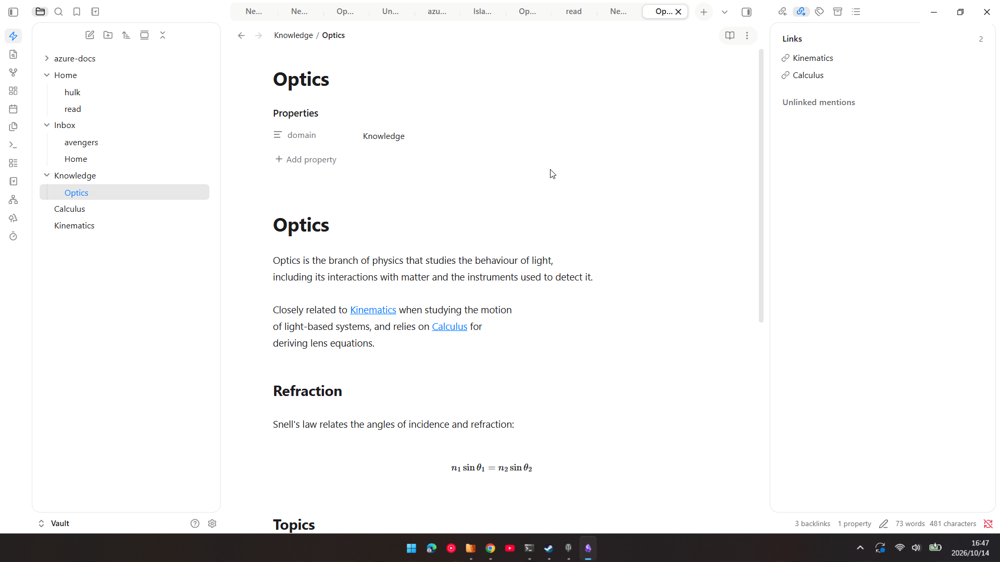
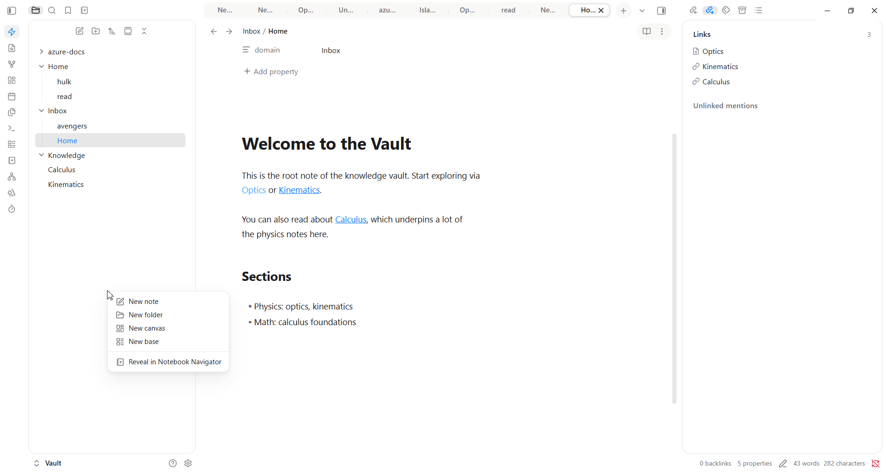

# Domain First File Allocator

**Type a folder's name into a note's `domain` property, and the note files itself there.**

Keeping notes tidy usually means dragging them into folders. This plugin lets you do it from the note itself: put the folder's path in a property, and a moment later the note moves. It also works the other way round, writing a note's folder into its property, so the two always agree.

A note's **domain** is simply the full path of a folder, such as `Areas/Finance`. There is no separate list of names to keep in sync, and every subfolder is its own domain.

## What it does

- **Files notes for you.** Change a note's domain and, a couple of seconds later, it moves to that folder. Links to it keep working.
- **Catches the strays.** A note with no domain goes to an `Inbox` folder, once you move on to another note.
- **Works backwards too.** One command writes a note's current folder into its domain.
- **Follows your folders.** Rename a domain folder and the plugin offers to update the notes that name it.
- **Lets you undo.** Every move can be reversed.

## Quick start

1. Install the plugin (see below) and open **Settings → Domain First File Allocator → Domains**.
2. Choose **Choose folder** and pick a folder, for example `Knowledge`.
3. In any note, set the `domain` property to that folder's path. A moment later the note is in the folder.

That's all. Notes are only filed into folders you have chosen as domains, plus the `Inbox` for notes that have no domain, and the plugin never moves a note you are still typing in.

## Commands

Open the command palette and search for "domain":

- **File note by domain** moves the open note to the folder named in its domain.
- **Set domain from folder** writes the open note's folder into its domain.
- **Undo last allocation** reverses the latest move or change.

No hotkeys are set, so nothing clashes with yours. You can add your own in **Settings → Hotkeys**.

## Turning automatic filing off

Automatic filing is on by default. Select the **lightning-bolt icon in the left ribbon** to switch it off and on. Right-click it (or use the Automatic filing page in settings) to pause it for 15 minutes or an hour.

## Install

**From Obsidian:** open **Settings → Community plugins → Browse**, search for "Domain First File Allocator", then install and enable it.

**By hand:** download `main.js`, `manifest.json` and `styles.css` from the [latest release](https://github.com/jrayas/domain-first-file-allocator/releases/latest), put them in `<your vault>/.obsidian/plugins/domain-first-file-allocator/`, then enable the plugin in **Settings → Community plugins**.

It needs Obsidian 1.13.1 or later, and works on desktop and mobile. Older versions of Obsidian install version 1.0.1, which needs Obsidian 1.6.6 or later.

## Settings at a glance

Every setting is in **Settings → Domain First File Allocator**, and Obsidian's settings search finds them too. The ones people change most:

| Setting | Default | What it does |
| --- | --- | --- |
| File notes automatically | On | Moves a note when you change its domain. |
| Fallback folder | `Inbox` | Where notes with no domain go. Created for you if it does not exist. |
| Excluded folders | `Templates` | Notes in these folders are never touched. |
| Add the domain property to new notes | On | Gives every new note an empty `domain`, ready to fill in. |
| Popup behaviour | Custom | Choose how often the plugin asks first: *Cautious*, *Balanced* or *Hands-off*. |

Every setting is explained in the [settings reference](docs/settings.md).

## Safe by design

- Moves use Obsidian's own file manager, so links are updated.
- It never deletes a note. The one exception is **Replace**, which asks twice and sends the old note to your trash.
- Anything that changes many notes shows a preview first, and can be undone as one action.
- A note with `skip-allocator: true` in its properties is always left alone.

## Requirements and disclosures

- **No network access.** The plugin makes no web requests, has no telemetry or analytics, and shows no ads. Nothing leaves your vault.
- **What it changes.** It moves notes between folders, edits the domain property in a note's frontmatter, and creates folders when needed, including the fallback folder (`Inbox` by default) at startup if it does not exist. By default it also adds an empty domain property to each new note.
- **Automatic filing is on by default.** It only acts on domains you have registered, and every move can be undone.
- **It reads your vault's file list.** To count notes per domain, find the notes affected by a folder rename and find notes with an empty domain, the plugin lists the files in your vault and reads each note's domain property from Obsidian's metadata cache. This is read-only and happens on your device.
- **One hidden file.** The plugin keeps a copy of its settings in `.domain/folder.json`, so they can be backed up and shared. Because a hidden folder is not part of Obsidian's note index, this one file is read and written through the vault adapter. You can rename the folder in settings. See [the data file](docs/data-file.md).

## Common questions

**Nothing moved. Why?** The domain probably isn't registered yet. Add the folder under **Domains** in settings, or check the [troubleshooting guide](docs/troubleshooting.md).

**A note moved while I was typing.** It shouldn't: a note with no domain waits until you leave it. If a typed domain moves too soon, turn on **Never move the open note** on the Automatic filing page.

**Can I stop it touching my templates?** Yes, and `Templates` is already excluded. Add other folders under **Excluded folders** on the General page.

**Does it work on my phone?** It's built for mobile, but so far it has only been checked on the desktop app. Reports from real devices are welcome.

## Learn more

- [How it works](docs/how-it-works.md): automatic filing step by step, new notes, folder changes, mobile.
- [Settings reference](docs/settings.md)
- [The data file](docs/data-file.md)
- [Troubleshooting](docs/troubleshooting.md)
- **For developers:** [DEVELOPING.md](DEVELOPING.md) covers building, the code layout and releasing, and [TESTING.md](TESTING.md) is the manual test checklist.

Found a bug or have an idea? Please [open an issue](https://github.com/jrayas/domain-first-file-allocator/issues).

## Licence

MIT. See [LICENSE](LICENSE).
